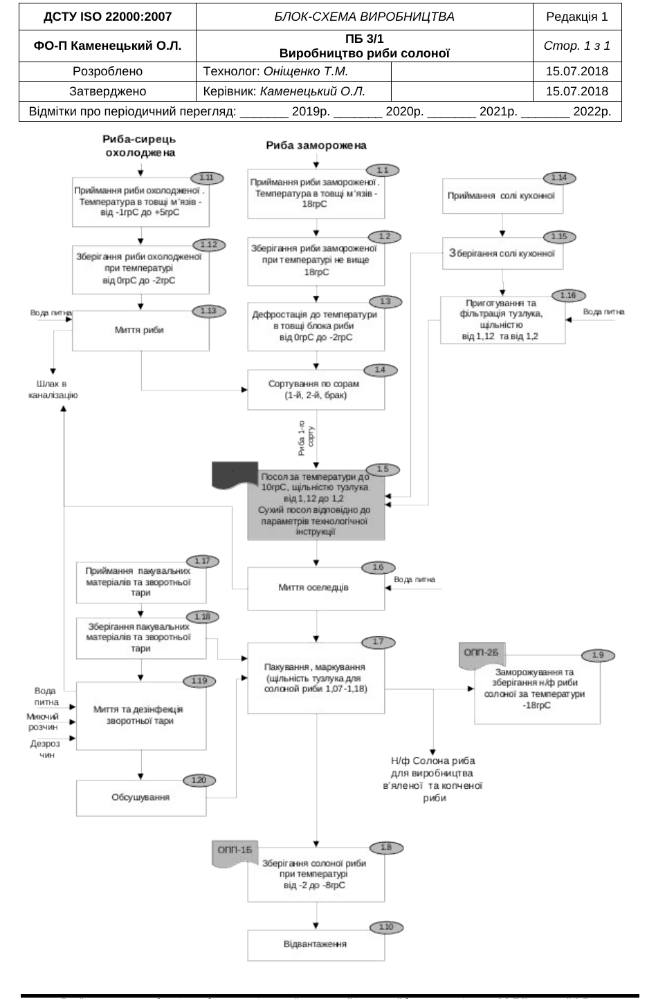
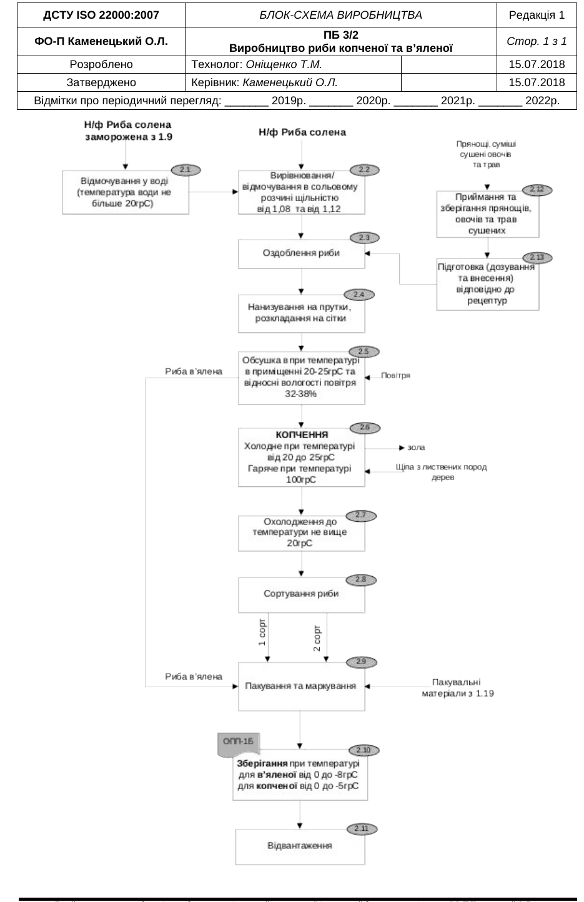

## Як користуватися

Довідник для працівників рибопереробного цеху «Риба Щодня» (ТОВ «ФІШ МАКСИМУМ ТРЕЙД» і ФОП Каменецький О.Л.). Знайдіть своє питання в розділі або через пошук: назву риби, «тузлук», «копчення», «відходи». Кожна відповідь — це кроки, норма і журнал, куди записати.

**Головне правило цеху:** показник поза нормою (температура, щільність тузлука, час) — зупиніть процес, позначте партію і повідомте технолога. Не «доганяйте» самі.

Норми взяті з документів НАССР цеху: блок-схеми ПБ 3/1 і ПБ 3/2, план НАССР (КТК-1Б, 2Б, 3Б), методика М 7.10-01, технологічні карти Оніщенко Т.М. (2020), технологічна інструкція пряного соління (2020), рецептури і ТУ цеху (2023), описи продукції ПБ2.

*Це чернетка. Цифри, де документи розходяться, позначені «уточнює технолог». Перед запуском довідник перевіряє технолог.*

## 1. Приймання сировини

### Що перевірити, коли привезли рибу? {#pryimannya}

1. Машину пускають на рампу тільки після перевірки: кузов цілий, чистий, без запаху бензину чи фарби, холодильник працює, у водія ТТН і медична книжка. Поставка є в плані на сьогодні.
2. Під час відвантаження готової продукції сировину **не приймають**.
3. Документи: накладна або ТТН, документ про якість і безпечність партії. Перевірте, що документи саме на цю партію, строк дії і строк зберігання.
4. Візьміть кілька ящиків (блоків) **з різних місць машини** і поміряйте пірометром або щупом температуру в товщі мʼязів:
   - морожена риба — **не вище −18 °C**;
   - охолоджена (риба-сирець) — **від −1 до +5 °C**.
5. Органолептика: запах, колір, консистенція, цілість пакування, маркування.
6. Розвантажуйте швидко: орієнтир — **15 хвилин на 1 тонну**, щоб риба не відтанула.
7. Камеру охолодіть заздалегідь: для мороженої до −18 °C, для охолодженої до −2 °C. Запишіть температуру в камері перед завантаженням.
8. Якщо сумніваєтесь — кличте технолога, остаточне рішення приймає вона.

Бланк: журнал вхідного контролю риби. Документ: М 7.10-01 (ПР1), ППУ 7.2.3-07.

### Що робити, якщо сировина не відповідає? {#vidmova}

1. Партію **не приймати** або приймати тільки умовно, до лабораторних результатів (рішення технолога).
2. Умовну партію («сумлінна якість») ставлять в окрему зону камери і чіпляють **жовтий аркуш** з даними про партію.
3. Невідповідну — в окрему зону, **червоний аркуш**.
4. Складіть акт у присутності водія, один примірник — постачальнику.
5. Повідомте постачальника.

Бланк: акт невідповідності. Документ: М 7.10-01 (ПР1, ПР4).

### Як приймати сіль, спеції, пакування і мийні засоби? {#dopomizhni}

1. Перевірте кількість, цілість пакування і документи про якість на цю партію.
2. Сіль і спеції — в окреме сухе приміщення складу, мішки на піддони. Ярлик на мішку зберігайте, поки мішок не спорожніє.
3. Умови складу: вологість повітря **не вище 75 %**, температура не вище 40 °C. Контроль гігрометром щодня.
4. Мийні і дезінфекційні засоби — тільки в окремому приміщенні для хімії, не поряд із сировиною.
5. Без приймання комірником у виробництво нічого не передають.

Бланк: щоденний чек-лист контролю виробництва. Документ: ППУ 7.2.3-07, ПБ1 (описи сировини).

## 2. Зберігання і камери

### Яка температура в якій камері? {#kamery}

| Що зберігаємо | Температура |
|---|---|
| Морожена сировина | не вище −18 °C |
| Охолоджена сировина | від 0 до −2 °C |
| Солона риба, посол і дозрівання (камера № 6) | від −4 до −8 °C |
| Солона риба (блок-схема ПБ 3/1) | від −2 до −8 °C |
| Солоний напівфабрикат для заморожування | −18 °C |
| Копчена риба | від 0 до −5 °C |
| Вʼялена риба | від 0 до −8 °C |
| Готова продукція після копчення і вʼялення | камера № 4 |
| Харчові відходи (камера № 1) | −18 °C |

Температуру записують **двічі на день: о 8:00 і о 16:00**. Раз на місяць комірник з технологом перевіряють кожну камеру повіреним термометром у 4 точках: біля входу, на протилежній стороні і в двох протилежних кутах.

Бланк: журнал температур. Документ: ППУ 7.2.3-07, блок-схеми ПБ 3/1, ПБ 3/2.

### Як правильно складати рибу в камері? {#skladannya}

1. Ящики — штабелями на підтоварниках, **не ближче 50 см від стін**.
2. Окремо за видами риби, сортами і датами надходження.
3. Маркування постачальника лишається на ящику, поки ящик не спорожніє.
4. Першим іде те, що прийшло раніше або має коротший строк (FIFO / FEFO).
5. Сировину, напівфабрикат і готову продукцію не ставлять разом без розділення.
6. Двері камер не тримати відчиненими, температура не повинна «гуляти» вгору.

Документ: ППУ 7.2.3-07.

### Камера показує температуру поза нормою — що робити? {#kamera-avariya}

1. Перевірте двері і показ повіреним термометром.
2. Перенесіть продукцію в іншу камеру з потрібною температурою.
3. Повідомте технолога і начальника дільниці; ремонт записують у журнал обладнання.
4. Продукцію, яка була поза температурою, позначте як «потенційно небезпечна» — рішення про неї приймає технолог.
5. Запишіть, що зроблено, у журнал температур.

Бланк: журнал температур. Документ: ППУ 7.2.3-07, ППУ 7.2.3-05.

## 3. Посол і тузлук

### Як розморожувати рибу перед посолом? {#defrostatsiya}

1. У ваннах з чистою змінною водою або слабким соляним розчином щільністю **1,02–1,03**, вода **не тепліше +20 °C**, риби до води **1 : 2**.
2. Розморожувати до розпадання блоків, коли в мʼязах **від −2 до 0 °C**.
3. Можна на повітрі при температурі не вище +20 °C; потім промити рибу у воді не тепліше +20 °C (води до риби 2 : 1).
4. Після розбирання промити водою не тепліше +15 °C (або соляним розчином не тепліше +5 °C) і дати стекти **20–30 хвилин**.
5. Тунець для стейків і балика розморожують до **−2 °C** у товщі (злегка підморожений).

*Блок-схема 2018 року (ПБ 3/1, перша редакція) пише «дефростація при +10…+15 °C не більше 4 год». Яка норма діє зараз — уточнює технолог.*

Документ: технологічна інструкція пряного соління (Оніщенко Т.М., 2020), блок-схема ПБ 3/1.

### Як приготувати тузлук потрібної щільності? {#tuzluk}

Таблиця технолога Оніщенко Т.М. Щільність міряють ареометром при +20 °C. Сіль — на **100 л прісної води**.

| Щільність, г/см³ | Солі на 100 л води, кг | Концентрація солі, % |
|---|---|---|
| 1,07 | 11,1 | 10 |
| 1,08 | 12,4 | 11 |
| 1,09 | 14,9 | 13 |
| 1,10 | 16,3 | 14 |
| 1,11 | 17,7 | 15 |
| 1,12 | 19,8 | 16 |
| 1,13 | 22,0 | 18 |
| 1,14 | 23,5 | 19 |
| 1,15 | 25,0 | 20 |
| 1,16 | 27,4 | 22 |
| 1,17 | 29,8 | 23 |
| 1,18 | 31,6 | 24 |
| 1,19 | 33,3 | 25 |
| 1,20 | 35,9 | 26 |

1. Розчиніть сіль у питній воді, профільтруйте тузлук.
2. Поміряйте щільність ареометром. Більша — долийте води, менша — досипте солі.
3. Тузлук має бути **прозорий, без бродіння, плісняви, сторонніх запахів**.
4. Запишіть щільність у журнал посолу.

*У технологічних картах 2020 року колонка «солі на 100 дм³ води» містить 163, 198, 316 — це ті самі 16,3, 19,8, 31,6 кг з таблиці, записані без коми. Уточнює технолог.*

Бланк: журнал посолу. Документ: таблиця щільності тузлука (Оніщенко Т.М.), КТК-1Б.

### Критична точка КТК-1Б: що контролювати при посолі? {#kktposol}

Посол — критична точка керування (КТК-1Б). Небезпека: виживання паразитів, наростання гістаміну і токсину ботулізму.

| Що контролюємо | Критична межа | Як часто |
|---|---|---|
| Щільність тузлука | **1,07–1,20 г/см³** | перед заливкою риби і 1 раз за зміну |
| Якість тузлука | прозорий, без бродіння, плісняви, сторонніх домішок і запахів | 1 раз на день |
| Температура в камері посолу | **не вище +10 °C** | 1 раз за зміну |
| Тривалість посолу | за технологічною картою на вид і розмір риби | початок і кінець кожного посолу |

**Якщо показник поза межею:**
1. Негайно виправте (сіль, вода, холод).
2. Повідомте технолога і керівника групи НАССР.
3. Партію відставте окремо і позначте «потенційно небезпечна продукція».
4. Не виходить швидко виправити — зупиніть посол.
5. Рішення про партію: безпечна / на інше використання / утилізація — приймає група НАССР.

Ареометр перевіряють другим ареометром, термометр камери — повіреним термометром.

Бланк: журнал посолу. Документ: план НАССР, КТК-1Б; М 7.10-01.

### Скільки солити рибу перед холодним копченням? {#posol-kholodne}

Технологічні карти поетапної підготовки риби до холодного копчення, частина 1 (Оніщенко Т.М., 2020). Посол — у камері посолу (не вище +10 °C). Сухий посол: сіль усередину черевної порожнини, рибу рядами навхрест.

| Риба, розробка | Розмір | Посол | Риба : тузлук | Тривалість посолу | Відмочування |
|---|---|---|---|---|---|
| Барабулька не розроблена | 16+ см | тузлук 1,10 | 1:1 | 2 доби | при необхідності |
| Бичок азово-чорноморський патраний | 16+ см | тузлук 1,18 | 1:1,5 | 5 годин | обовʼязково 15 хв |
| Бичок азово-чорноморський тушка без шкури | 6–9 см | тузлук 1,07 | 1:1 | 30 хв | ні |
| Варіхоу не розроблена (розробити без голови) | 800–1000 г | тузлук 1,08 | 1:1 | 2 доби | при необхідності |
| Варіхоу тушка | 800–1200 г (1200+ — колоти мʼясо вздовж хребта) | тузлук 1,10 | 1:1 | 2,5 доби | при необхідності |
| Вомер не розроблений | 100–200 / 200–300 / 300–500 г | тузлук 1,10 | 1:1 | 1 доба / 2 доби / 2,5 доби | при необхідності |
| Голець тушка | 1000–3000 г | тузлук 1,18 | 1:1,15 | 3–4 доби | обовʼязково до 40 хв |
| Горбуша без голів патрана | 900+ / 1000+ г | тузлук 1,10 | 1:1 | 2 доби | при необхідності |
| Есколар філе (шматки 12–14 см) | 3000 / 5000 г | тузлук 1,18 | 1:1,5 | 1 доба / 1,5 доби | обовʼязково 10–15 хв |
| Кальмар гігантський філе (смужки 3×20–30 см) | 3000+ г | тузлук 1,10 | 1:1 | 2 хв | обовʼязково 1 хв |
| Камбала балтійська не розроблена | 16 см | тузлук 1,10 | 1:1 | 2 доби | при необхідності |
| Камбала палтусна без голів | 800+ г | тузлук 1,10 | 1:1 | 1 доба | при необхідності |
| Карась патраний | будь-який | сухий посол, 30 % солі від маси риби | — | до 12–14 діб | обовʼязково ступеневе до 1,5 доби при t нижче 10 °C |
| Кета патрана без голів | 900–1800 г | тузлук 1,10 | 1:1,5 | 2 доби | при необхідності до 20 хв |
| Кижуч патраний без голів | 1800–2700 г | тузлук 1,10 | 1:1,5 | 2 доби | при необхідності до 20 хв |
| Кобія кусок (20–25 см) | 1300 г | тузлук 1,18 | 1:1,5 | 4 доби | обовʼязково 40–50 хв |
| Короп пласт | від 1000 г | сухий посол, 25 % солі від маси риби | — | 12–14 діб | обовʼязково ступеневе до 1,5 доби при t нижче 10 °C |
| Корюшка не розроблена | 12–16 / 16–20 см | тузлук 1,18 | 1:1 | 2 год / 2,5 год | при необхідності |
| Лосось кусок (стейк) | 500–700 г | тузлук 1,18 | 1:1,15 | 3 доби | обовʼязково до 30 хв |
| Лосось тушка | 1800–2700 / 2700–3500 г | тузлук 1,18 | 1:1,15 | 4 доби / 5 діб | обовʼязково 40–50 хв |
| Лосось філе | 1500–2200 г | тузлук 1,18 | 1:1,15 | 1 доба | обовʼязково до 10 хв |
| Лящ не розроблений | до 1000 г | сухий посол, 25 % солі від маси риби | — | до 14 діб | обовʼязково ступеневе до 1,5 доби при t нижче 10 °C |
| Лящ патраний | від 1000 г | сухий посол, 30 % солі від маси риби | — | до 14 діб | обовʼязково ступеневе до 1,5 доби при t нижче 10 °C |
| Лящ пласт | від 1200 г | сухий посол, 25 % солі від маси риби | — | 12–14 діб | обовʼязково ступеневе до 1,5 доби при t нижче 10 °C |
| Мойва не розроблена | 30–40 / 35–45 шт. на 1 кг | тузлук 1,18 | 1:1,5 | 40 хв | при необхідності |
| Оселедець атлантичний не розроблений | 200 / 200–300 / 300+ / 350+ г | тузлук 1,09 / 1,12 / 1,15 / зимою 1,15, літом 1,16 | 1:1 | 1 доба | при необхідності |
| Оселедець атлантичний філе | 6–8 шт. на 1 кг | тузлук 1,12 | 1:1 | 6 хв | при необхідності |
| Осетр теша | 800–1200 г | тузлук 1,18 | 1:1,5 | 18 год | обовʼязково 20 хв |
| Осетр філе (балик) | 2000–3000 г | тузлук 1,18 | 1:1,5 | 18 год | обовʼязково 20 хв |
| Помпаніто не розроблена | 18–30 см | тузлук 1,10 | 1:1 | 2 доби | при необхідності |
| Путасу не розроблена | 18 см | тузлук 1,18 | 1:1 | зимою 35–40 хв, літом 50–60 хв | при необхідності |
| Сайра не розроблена | 120–140 | тузлук 1,14 | 1:1 | 1 доба | при необхідності |
| Салака балтійська без голів | 8–10 см | тузлук 1,18 | 1:1,5 | 40 хв | при необхідності |
| Салака балтійська не розроблена | 16 см | тузлук 1,18 | 1:1,15 | зимою 35–40 хв, літом 1 год | при необхідності |
| Сардинопс не розроблений | 25–30 см | тузлук 1,12 | 1:1 | 1,5 доби | при необхідності |
| Свистулька не розроблена | 400+ г | тузлук 1,10 | 1:1,5 | 1 доба | при необхідності |
| Скумбрія без голів (видалити нутрощі) | 400–600 / 600+ г | тузлук 1,15 | 1:1,15 | 1 доба / 1 доба + 2 год | обовʼязково до 5 хв |
| Скумбрія блакитна без голів | 600–900 / 900–1200 г | тузлук 1,10 | 1:1 | 2 доби / 2,5–3 доби | при необхідності |
| Скумбрія не розроблена (відкрити жаберні кришки) | 300–500 / 400–600 / 600+ г | тузлук 1,18 | 1:1,15 | 2 доби / 2 доби + 2 год / 2,5 доби | обовʼязково до 5 хв |
| Сом кларієвий патраний без голів | 25 см | тузлук 1,10 | 1:1 | 2 доби | при необхідності |
| Сом патраний без голів | 900–1200 г | тузлук 1,10 | 1:1,5 | 2 доби | при необхідності |
| Сом річковий кусок (20–25 см) | 3000+ г | тузлук 1,18 | 1:2 | 7–14 діб (у карті виправлено від руки) | обовʼязково ступеневе 1,5 доби |
| Ставрида без голів | до 600 / 600–900 / 900–1200 / 1200+ (колоти мʼясо вздовж хребта) | тузлук 1,10 | 1:1 | до 2 діб / до 2,5 доби / до 3 діб / до 3 діб | при необхідності |
| Ставрида не розроблена | 30–35 см | тузлук 1,16 | 1:1 | 1 доба | при необхідності |
| Товстолоб без голів патраний | до 1200 г | сухий посол, 30 % солі від маси риби | — | до 14 діб | обовʼязково ступеневе до 1,5 доби при t нижче 10 °C |
| Товстолоб пласт | 1200–1800 г | сухий посол, 25 % солі від маси риби | — | до 16 діб | обовʼязково ступеневе до 1,5 доби при t нижче 10 °C |
| Форель кусок (стейк) | 500–700 г | тузлук 1,18 | 1:1,15 | 3 доби | обовʼязково до 30 хв |
| Форель тушка | 1800–2700 г | тузлук 1,18 | 1:1,15 | 4 доби | обовʼязково до 40 хв |
| Хребти лосося (форелі) | — | тузлук 1,12 | 1:1 | 15 хв | при необхідності |

Необхідність відмочування визначає технолог або той, хто виконує обовʼязки технолога.

Бланк: журнал посолу. Документ: технологічні карти до холодного копчення, ч. 1.

### Скільки солити рибу перед гарячим копченням? {#posol-garyache}

Технологічні карти поетапної підготовки риби до гарячого копчення, частина 1 (Оніщенко Т.М., 2020). Тривалість — у хвилинах. «Оцет 1 %» — 9 % оцет у кількості 1 % від маси риби. Відмочування в усіх, крім хребтів лосося, — при необхідності.

| Риба, розробка | Розмір | Посол | Риба : тузлук | Тривалість посолу | Обвʼязка шпагатом |
|---|---|---|---|---|---|
| Амур патраний (можна кусками) | — | тузлук 1,18 + оцет 9 % — 1 % від маси риби | 1:1 | 40 хв | шпагат |
| Аргентина без голів | 300+ г | тузлук 1,18 | 1:1 | 25 хв | шпагат |
| Барабулька патрана | 16+ см | тузлук 1,18 | 1:1 | 25 хв | ні |
| Барракуда тушка (кусками) | 800+ г | тузлук 1,18 | 1:1 | 40 хв | шпагат |
| Брама без голови | — | тузлук 1,18 | 1:1 | 75 хв | шпагат |
| Веслоніс (кусками) | — | тузлук 1,18 | 1:1 | 20 хв | шпагат |
| Горбуша без голови патрана | 1000+ г | тузлук 1,18 (у карті «1,188») | 1:1 | 25–30 хв | шпагат |
| Дорадо патрана | 400–600 / 600–800 г | тузлук 1,18 | 1:1 | 45 хв / 55 хв | шпагат |
| Камбала балтійська без голови | до 20 см | тузлук 1,18 | 1:1 | 3–5 хв | шпагат |
| Камбала без голови 2-х лінійна | 400+ г | тузлук 1,18 | 1:1 | 35–40 хв | шпагат |
| Карась пласт (охолоджений, свіжоморожений) | — | тузлук 1,18 + оцет 9 % — 1 % від маси риби | 1:1,5 | 30 хв / 25 хв | ні |
| Кефаль (піленгас) патрана | 25–30 см | тузлук 1,18 | 1:1 | 20 хв | шпагат |
| Короп пласт (охолоджений, свіжоморожений) | — | тузлук 1,18 + оцет 9 % — 1 % від маси риби | 1:1,5 | 35 / 55 хв (у карті виправлено від руки) | ні |
| Красноглазка не розроблена | 400–600 г | тузлук 1,18 | 1:1 | 1 год 30 хв | ні |
| Лосось патраний | 400–600 г | тузлук 1,18 | 1:1 | 35–40 хв | шпагат |
| Лосось філе (однакові куски) | 1000+ г | тузлук 1,07 | 1:1 | 10 хв | звʼязати попарно шкірою назовні |
| Лящ патраний чищений | 800+ г | тузлук 1,18 + оцет 9 % — 1 % від маси риби | 1:1 | 30 хв / 25 хв | шпагат |
| Лящ пласт (охолоджений, свіжоморожений) | — | тузлук 1,18 + оцет 9 % — 1 % від маси риби | 1:1,5 | 50 хв (охолоджений) / 30 хв (свіжоморожений) | ні |
| Марлін філе (куски 400–600 г, оздобити за рецептурою) | 3000+ г | тузлук 1,18 | 1:1 | 60 хв + дозрівання 1 доба | шпагат |
| Муксун тушка | 800+ г | тузлук 1,18 | 1:1 | 30 хв | шпагат |
| Мідії | 100–200 шт. на 1 кг | тузлук 1,07 | 1:1 | 30 секунд | ні |
| Нототенія тушка | 100–300 г | тузлук 1,18 | 1:1 | 30 хв | ні |
| Окунь без голови | 200–300 / 300–500 / 500–700 г | тузлук 1,18 | 1:1 | 45 хв / 55 хв / 1 год 10 хв | шпагат |
| Оселедці атлантичні не розроблені | 200 / 300+ / 350+ г | тузлук 1,18 | 1:1 | 40 / 60 / 70 хв | шпагат |
| Оселедці атлантичні філе (рулет) | 6–8 шт. на 1 кг | сухий посол, 0,5 % від маси | — | дозрівання 1 доба | шпагат |
| Помпаніто не розроблена | 30 см / 20 см | тузлук 1,18 | 1:1 | 17 хв / 10 хв | шпагат |
| Салака балтійська не розроблена | 14–16 / 20+ см | тузлук 1,18 | 1:1,5 | 25 хв / 35 хв | ні |
| Скумбрія атлантична без голови | 400–600 г | тузлук 1,18 | 1:1 | 40 хв | шпагат |
| Скумбрія атлантична філе (рулет) | — | сухий посол, 0,5 % від маси риби | — | дозрівання 1 доба | шпагат |
| Скумбрія блакитна без голови (можна кусками) | 600–900 г | тузлук 1,18 | 1:1 | 40–45 хв | шпагат |
| Сом кларієвий без голови | 30 см | тузлук 1,18 | 1:1 | 35 хв | шпагат |
| Сом кусок | 400–600 г | тузлук 1,18 | 1:1 | 45 хв | шпагат |
| Сонячник без голів | 12–15 / 18–25 / 30+ см | тузлук 1,18 | 1:1 | 20 / 30 / 40 хв | шпагат |
| Ставрида без голови | до 600 / 600–900 г | тузлук 1,18 | 1:1 | 50–60 хв / 70 хв | шпагат |
| Судак патраний | 600–800 г | тузлук 1,18 | 1:1 | 45 хв | шпагат |
| Сібас патраний | 400–600 / 600–800 г | тузлук 1,18 | 1:1 | 40 хв / 55 хв | шпагат |
| Товстолоб пласт (охолоджений, свіжоморожений) | — | тузлук 1,18 + оцет 9 % — 1 % від маси риби | 1:1,5 | 55 хв / 35 хв | ні |
| Тунець патраний (кусками) | — | тузлук 1,18 | 1:1 | 40 хв | шпагат |
| Форель патрана | 400–600 г | тузлук 1,18 | 1:1 | 35–40 хв | шпагат |
| Хек тушка | 25 см | тузлук 1,18 | 1:1 | 25 хв | ні |
| Хребти лосося | — | тузлук 1,18 | 1:1 | 1 хв (відмочування обовʼязково 1 хв) | шпагат |

Бланк: журнал посолу. Документ: технологічні карти до гарячого копчення, ч. 1.

### Скільки солити рибу перед вʼяленням? {#posol-vyalennya}

Дивіться таблицю в питанні [«Вʼялення: посол і тривалість по кожній рибі»](#q-vyalennya-ryba).

### Як солять сухим посолом річкову рибу? {#sukhyi-posol}

1. Зачистити черевну порожнину, за потреби помити.
2. Сіль — **20–30 % від маси риби** (дивіться таблицю на свою рибу), частину солі — всередину черевної порожнини.
3. Рибу вкладати рівними щільними рядами навхрест, кожен ряд пересипати сіллю.
4. Тривалість — **12–16 діб** залежно від риби.
5. Перед вʼяленням або копченням — **обовʼязкове ступеневе відмочування до 1,5 доби при воді нижче +10 °C**.

Документ: технологічні карти Оніщенко Т.М., 2020.

### Як зробити рибу пряного соління і мариновану? {#pryanyi-posol}

За технологічною інструкцією Оніщенко Т.М. (2020) і ТУ У 10.20.23-2599110837-004:2023.

1. Спочатку солоний напівфабрикат: посол тузлуком **до вмісту солі в мʼясі 5–8 %**.
2. Напівфабрикат перемішати з сумішшю прянощів і цукру (рецептура на вид риби) і вкласти у відра рядами навхрест, верхній ряд — спинкою догори; лавровий лист зверху і знизу.
3. Залити чистим соляним розчином обережно, щоб не змити прянощі:
   - скумбрія, ставрида слабосолені — **1,11–1,12**, середньосолені — **1,12–1,13**;
   - розчину — **15–20 % від маси риби** (оселедці і сардини — 10–15 %);
   - рівень заливки на 2–3 см вище риби (ТУ 004).
4. Маринована: у заливку додати оцтову кислоту так, щоб у заливці було **4–6 % кислоти**.
5. Дозрівання — у камері № 6 при −4…−8 °C **5–7 діб**; на 7-й день огляд; якщо не дозріла — до 10 діб. У магазини відвантажують **тільки дозрілу**.
6. Норми готового: сіль у мʼясі **6–10 %**, оцтова кислота в маринованій **0,6–1,0 %** (ТУ 004).

*Строк зберігання: інструкція 2020 року — 30 діб у камері № 6; ТУ 004:2023 — 20 діб у відрах. Діє ТУ, підтверджує технолог.*

Бланк: журнал посолу. Документ: технологічна інструкція пряного соління (2020), ТУ 004.

## 4. Копчення

### Критична точка КТК-2Б: що контролювати при копченні? {#kktkopchennya}

| Що контролюємо | Критична межа | Як часто |
|---|---|---|
| Температура в коптильній камері, гаряче копчення | **від 60 до 100 °C** | кожне копчення, весь час |
| Температура в коптильній камері, холодне копчення | **від 25 до 35 °C** | кожне копчення, весь час |
| Тривалість | за технологічною картою на вид риби | кожне копчення |

Контролює оператор коптильної установки за датчиком камери. Датчик періодично звіряють з повіреним термометром.

**Якщо поза межею:** виправте режим, повідомте технолога, партію позначте «потенційно небезпечна», не вдається — зупиніть копчення.

*Температура в товщі продукту при гарячому копченні в документах не встановлена, хоча щупи в камерах є. Межу задає технолог.*

Бланк: журнал копчення. Документ: план НАССР, КТК-2Б.

### Як іде процес копчення по кроках? {#kopchennya-kroky}

1. Солона риба → вирівнювання (відмочування) в сольовому розчині **1,08–1,12** або у воді **не тепліше +20 °C**.
2. Оздоблення риби спеціями за рецептурою (якщо передбачено).
3. Нанизування на прутки (шомпола) або розкладання на сітки так, щоб риба не торкалась.
4. Миття під душем, стікання **не менше 20 хвилин**.
5. Підсушка: **+16…+24 °C** з інтенсивною циркуляцією повітря (блок-схема ПБ 3/2: +20…+25 °C, вологість 32–38 %).
6. Копчення: щепа **листяних порід** дерев. Режим — за таблицею на вид риби.
7. Охолодження до температури приміщення (не вище **+20 °C**).
8. Сортування (1-й, 2-й сорт), пакування, маркування, зважування.
9. Зберігання — камера № 4, копчена **від 0 до −5 °C**.

Бланк: журнал копчення. Документ: блок-схема ПБ 3/2, технологічні карти Оніщенко Т.М.

### Гаряче копчення: режим по кожній рибі {#kopchennya-garyache}

Технологічні карти до гарячого копчення, частина 2 (Оніщенко Т.М., 2020). Перед копченням — миття під душем і стікання не менше 20 хв (крім пластів, мідій, рулетів — «не сушити»). Після — охолодження, сортування, пакування, камера № 4.

| Риба, розробка | Підсушка 16–24 °C, год | Копчення, °C | Копчення, хв | Дим |
|---|---|---|---|---|
| Амур кусок патраний | 15 | 100 | 45 | останні 15 хв |
| Аргентина без голів | 15 | 60 | 60 | весь час |
| Барабулька патрана | 15 | 100 | 35 | останні 15 хв |
| Барракуда кусок | 15 | 100 | 40 | останні 15 хв |
| Брама без голови | 15 | 100 | 40 | останні 15 хв |
| Веслоніс кусок | 15 | 100 | 35 | останні 15 хв |
| Горбуша патрана, кусок без голови | 15 | 100 | 40 | останні 15 хв |
| Дорадо патрана | 15 | 100 | 60 | останні 15 хв |
| Камбала двохлінійна без голови, балтійська | 15 | 60 | 60 | весь час |
| Карась пласт | не сушити | 100 | 90 | останні 15 хв |
| Короп пласт | не сушити | 100 | 120 | останні 15 хв |
| Красноглазка не розроблена | 15 | 60 | 60 | весь час |
| Ксораль патрана | 15 | 100 | 35 | останні 15 хв |
| Линь патраний | 15 | 100 | 60 | останні 15 хв |
| Лосось патраний | 15 | 100 | 30 | останні 15 хв |
| Лосось філе (бутерброди) | 15 | 100 | 15 | останні 15 хв |
| Лящ патраний чищений | 15 | 100 | 35 | останні 15 хв |
| Лящ пласт | не сушити | 100 | 100 | останні 15 хв |
| Марлін філе кусок | не сушити | 100 | 60 | без диму |
| Муксун тушка | 15 | 60 | 60 | весь час |
| Мідії | не сушити | 100 | 10 | останні 5 хв |
| Нототенія тушка | 15 | 60 | 60 | весь час |
| Окунь без голови | 15 | 100 | 60 | останні 15 хв |
| Оселедець не розроблений | 15 | 60 | 40 | весь час |
| Оселедці філе рулети | не сушити | 100 | 25 | останні 10 хв |
| Помпаніто не розроблена | 15 | 100 | 35 | останні 15 хв |
| Салака балтійська не розроблена | 15 | 60 | 30 | весь час |
| Скумбрія без голів | 15 | 60 | 60 | весь час |
| Скумбрія блакитна патрана, кусок без голови | 15 | 60 | 60 | весь час |
| Скумбрія філе рулети | не сушити | 100 | 25 | останні 10 хв |
| Сом кларієвий без голови | 15 | 100 | 45 | останні 15 хв |
| Сом кусок | 15 | 100 | 60 | останні 15 хв |
| Сонячник без голів | 15 | 100 | 35–45 | останні 15 хв |
| Ставрида без голови | 15 | 100 | 60 | останні 15 хв |
| Судак патраний | 15 | 100 | 60 | останні 15 хв |
| Сібас патраний | 15 | 100 | 60 | останні 15 хв |
| Товстолоб пласт | не сушити | 100 | 120 | останні 15 хв |
| Тунець патраний | 15 | 100 | 40 | останні 15 хв |
| Форель патрана | 15 | 100 | 30 | останні 15 хв |
| Хек тушка | 15 | 60 | 60 | весь час |
| Хребти лосося | не сушити | від 75 | 20 | останні 10 хв |

*Підсушка в картах вказана «15 годин» — для гарячого копчення це довго; у рецептурі «Скумбрія Святкова» — 2–4 години. Уточнює технолог.*

Бланк: журнал копчення. Документ: технологічні карти до гарячого копчення, ч. 2.

### Холодне копчення: режим по кожній рибі {#kopchennya-kholodne}

Технологічні карти до холодного копчення, частина 2 (Оніщенко Т.М., 2020). Дим подається весь час. Після копчення — охолодження, сортування, пакування, камера № 4.

| Риба, розробка | Підсушка 16–24 °C, год | Копчення, °C | Копчення, год |
|---|---|---|---|
| Барабулька не розроблена | 16 | 25–28 | 1,0–1,3 |
| Бичок азово-чорноморський патраний | 16–18 | 25–30 | 1,0–1,3 |
| Бичок азово-чорноморський тушка без шкури | без циркуляції, 6 | 25–30 | 0,3–1,2 |
| Варіхоу без голів | 16 | 25–28 | 1,3–1,45 |
| Варіхоу тушка | 16 | 25–28 | 1,3–1,45 |
| Вомер не розроблений | 15 | 25–28 | 1,0–1,3 |
| Голець тушка | 15 | 25–28 | 1,5–2,0 |
| Горбуша без голів | 16 | 25–28 | 1,0–1,3 |
| Есколар філе | 15 | 25–28 | 0,3–1,0 |
| Кальмар гігантський філе | 16–18 | 25–30 | 0,3–1,0 |
| Камбала балтійська не розроблена | 15–16 | 25–28 | 1,0–1,3 |
| Камбала палтусна без голів | 15–16 | 25–28 | 1,0–1,3 |
| Карась патраний | 16–18 | 25–32 | 1,3–2,0 |
| Кета патрана без голів | 16 | 25–28 | 1,0–1,3 |
| Кижуч патраний без голів | 16 | 25–28 | 1,0–1,3 |
| Кобія кусок | 15 | 25–28 | 1,0–1,3 |
| Короп патраний | 16–18 | 25–32 | 1,3–2,0 |
| Короп пласт | 16–18 | 25–32 | 0,3–1,0 |
| Корюшка не розроблена | 15 | 25–28 | 0,5–1,0 |
| Лосось кусок (стейк) | 15 | 25–28 | 1,0–1,3 |
| Лосось тушка | 15 | 25–28 | 1,5–2,0 |
| Лосось філе | 15 | 25–28 | 0,4–1,0 |
| Лящ не розроблений | 16 | 25–32 | 1,3–2,0 |
| Лящ патраний | 16–18 | 25–32 | 1,3–2,0 |
| Лящ пласт | 16–18 | 25–32 | 0,3–1,0 |
| Мойва не розроблена | без інтенсивної циркуляції, 15 | 25–28 | 0,3–1,0 |
| Оселедець атлантичний не розроблений | 6 | 25–28 | 1,0–1,3 |
| Оселедець атлантичний філе | без інтенсивної циркуляції, 15 | 25–28 | 0,3–1,0 |
| Осетр теша | 15–16 | 25–28 | 0,3–1,0 |
| Осетр філе (балик) | 15–16 | 25–28 | 0,3–1,0 |
| Помпаніто не розроблена | 16 | 25–28 | 1,0–1,3 |
| Путасу не розроблена | 16–18 | 25–30 | 1,0–1,3 |
| Сайра не розроблена | 10 | 25–28 | 1,0–1,3 |
| Салака балтійська без голів | без інтенсивної циркуляції, 15 | 25–28 | 1,0–1,3 |
| Салака балтійська не розроблена | без інтенсивної циркуляції, 15 | 25–28 | 1,0–1,3 |
| Сардинопс не розроблений | 16–18 | 25–30 | 1,0–1,3 |
| Свистулька не розроблена | 16–18 | 25–28 | 1,0–1,3 |
| Скумбрія атлантична не розроблена | 6 | 25–28 | 1,0–1,3 |
| Скумбрія без голів | 6 | 25–28 | 1,0–1,3 |
| Скумбрія блакитна без голів | 15–16 | 25–28 | 1,0–1,5 |
| Сом кларієвий патраний без голів | 15 | 25–28 | 1,0–1,3 |
| Сом патраний без голів | 16–18 | 25–28 | 1,0–1,3 |
| Сом річковий кусок | 16–18 | 25–28 | 1,0–1,3 |
| Ставрида без голів | 16–18 | 25–30 | 1,0–1,3 |
| Ставрида не розроблена | 16–18 | 25–30 | 1,0–1,3 |
| Товстолоб без голів патраний | 16–18 | 25–32 | 1,3–2,0 |
| Товстолоб пласт | 16–18 | 25–32 | 0,3–10,0 (так у карті — перевірити) |
| Форель кусок (стейк) | 15 | 25–28 | 1,0–1,3 |
| Форель тушка | 15 | 25–28 | 1,5–2,0 |
| Хребти лосося (форелі) | 6 | 25–28 | 0,3–1,0 |

*У картах «тривалість, годин» 0,3–2,0 — для холодного копчення це коротко; перевірте одиниці (години чи доби). Для товстолоба пласта вказано 0,3–10,0. Уточнює технолог.*

Бланк: журнал копчення. Документ: технологічні карти до холодного копчення, ч. 2.

### Як охолоджувати і пакувати копчену рибу? {#pakuvannya}

1. Охолодити до температури приміщення, не вище +20 °C.
2. Видалити розпорки, шпагат, якщо пакуєте тушки.
3. Сортувати: 1-й, 2-й сорт; брак — окремо з написом «БРАК».
4. В одній упаковці — одна назва, сорт, дата виготовлення.
5. Пакування: вакуум або плівка; на етикетці — назва, склад, маса, дата і **номер партії**, умови і строк зберігання, виробник з адресою потужності, ТУ.
6. Одразу в камеру № 4.

Документ: ПБ2 (описи готової продукції), ТУ 003, 005.

## 5. Вʼялення

### Критична точка КТК-3Б: що контролювати при вʼяленні? {#kktvyalennya}

| Що контролюємо | Критична межа | Як часто |
|---|---|---|
| Температура в камері вʼялення | **від +16 до +27 °C** | 1 раз на день на кожну партію |
| Відносна вологість повітря | **від 33 до 62 %** | 1 раз на день |
| Тривалість вʼялення | **2–5 діб** за картою на вид риби | кожна партія |

Контролюють технолог і начальник дільниці. Поза межею — виправити режим, повідомити технолога, партію позначити «потенційно небезпечна».

*Блок-схема ПБ 3/2 для сушки дає вологість 32–38 %, план НАССР — 33–62 %. Уточнює технолог.*

Бланк: журнал вʼялення. Документ: план НАССР, КТК-3Б.

### Вʼялення: посол і тривалість по кожній рибі {#vyalennya-ryba}

Технологічні карти поетапної підготовки риби до вʼялення (Оніщенко Т.М., 2020). Після посолу: миття під душем, стікання не менше 20 хв, вʼялення з інтенсивною циркуляцією повітря **+16…+27 °C**, охолодження, пакування, камера № 4.

| Риба, розробка | Розмір | Посол | Риба : тузлук | Тривалість посолу | Відмочування | Вʼялення 16–27 °C |
|---|---|---|---|---|---|---|
| Амур патраний | 800–1000 г | сухий посол, 30 % солі від маси риби | — | 14 діб | ступеневе, при t нижче 10 °C | до 5 діб |
| Барабулька не розроблена | 16+ см | тузлук 1,10 | 1:1 | 2 доби | при необхідності | до 4 діб |
| Бичок азово-чорноморський патраний | 16+ см | тузлук 1,18 | 1:1,5 | 5 год | обовʼязково 15 хв | до 3 діб |
| Вомер макулата не розроблений | 200–300 г | тузлук 1,10 | 1:1 | 2 доби | при необхідності | до 4 діб |
| Вомер не розроблений | 100–150 / 200–300 г | тузлук 1,10 | 1:1 | 1 доба / 2 доби | при необхідності | до 4 діб |
| Густір (плоскирка) не розроблений | 200–500 г | сухий посол, 20 % солі від маси риби | — | 14 діб | ступеневе, при t нижче 10 °C | до 5 діб |
| Жерех патраний, полупласт | 600–800 г | сухий посол, 30 % солі від маси риби | — | 14 діб | ступеневе, при t нижче 10 °C | до 5 діб |
| Жовтопірка не розроблена | 14–16 см | тузлук 1,18 | 1:1 | 40–50 хв | при необхідності | до 3 діб |
| Карась патраний | будь-який | сухий посол, 30 % солі від маси риби | — | 14 діб | ступеневе, при t нижче 10 °C | до 5 діб |
| Корюшка не розроблена | 12–16 / 16–20 см | тузлук 1,18 | 1:1,5 | 2 год / 2,5 год | при необхідності | до 3 діб |
| Краснопір не розроблений | 300–500 г | сухий посол, 20 % солі від маси риби | — | 14 діб | ступеневе, при t нижче 10 °C | до 5 діб |
| Лящ не розроблений | до 1000 г | сухий посол, 25 % солі від маси риби | — | 14 діб | ступеневе, при t нижче 10 °C | до 5 діб |
| Лящ патраний | від 1000 г | сухий посол, 30 % солі від маси риби | — | 14 діб | ступеневе, при t нижче 10 °C | до 5 діб |
| Ліст не розроблений | 150–200 г | тузлук 1,10 | 1:1 | 2 доби | при необхідності | до 4 діб |
| Мойва не розроблена | 30–40 шт. на 1 кг | тузлук 1,18 | 1:1 | зимою 40 хв, літом 50–60 хв | при необхідності | до 2 діб |
| Окунь патраний | 300–400 г | сухий посол, 30 % солі від маси риби | — | 14 діб | ступеневе, при t нижче 10 °C | до 4 діб |
| Плітка не розроблена | 300–500 г | сухий посол, 20 % солі від маси риби | — | 14 діб | ступеневе, при t нижче 10 °C | до 5 діб |
| Путасу не розроблена | 18+ см | тузлук 1,18 | 1:1 | 40 хв | при необхідності | до 2 діб |
| Салака балтійська не розроблена | 16–18 см | тузлук 1,18 | 1:1,5 | зимою 40 хв, літом 1 год 10 хв | не обовʼязково | до 3 діб |
| Скумбрія не розроблена (відкрити жаберні кришки) | 400–600 г | тузлук 1,18 | 1:1,5 | 2 доби 2 год | обовʼязково 5 хв | до 4 діб |
| Судак патраний | 300–400 / 600–800 г | сухий посол, 30 % солі від маси риби | — | 14 діб | ступеневе, при t нижче 10 °C | до 5 діб |
| Щука патрана | 800–1000 г | сухий посол, 30 % солі від маси риби | — | 14 діб | ступеневе, при t нижче 10 °C | до 5 діб |

Бланк: журнал вʼялення. Документ: технологічні карти до вʼялення.

### Як вʼялити рибу по кроках? {#vyalennya}

1. Солону рибу відмочити (якщо треба — вирішує технолог).
2. Наколоти на шомпола як вказано в карті (у «вушка» над жаберною кісткою, за хвіст, «жабрувати» великих), розпорки в черевну порожнину.
3. Миття під душем, стікання не менше 20 хвилин.
4. Вʼялення: **+16…+27 °C**, вологість **33–62 %**, інтенсивна циркуляція. Температуру і вологість записувати щодня.
5. Тривалість — до 2–5 діб за картою.
6. Охолодження, видалити розпорки, сортування, пакування, зважування.
7. Зберігання **від 0 до −8 °C**, камера № 4.

Бланк: журнал вʼялення. Документ: КТК-3Б, технологічні карти до вʼялення, ГОСТ 1551, ТУ 001.

## 6. Контроль і журнали

### Які критичні точки є в цеху? {#kkt}

| ККТ | Етап | Критична межа | Хто і як часто |
|---|---|---|---|
| КТК-1Б | Посол | тузлук **1,07–1,20**, t тузлука **не вище +10 °C** | начальник дільниці, щозміни |
| КТК-2Б | Копчення | гаряче **+60…+100 °C**, холодне **+25…+35 °C**, час за картою | начальник дільниці, кожне копчення |
| КТК-3Б | Вʼялення | **+16…+27 °C**, вологість **33–62 %**, **2–5 діб** | технолог, щодня |

Інші етапи — операційні програми передумов (ОПП-1Б, ОПП-2Б): приймання, зберігання, миття, гігієна, відходи, шкідники.

Перевірку (верифікацію) плану НАССР керівник групи НАССР проводить **двічі на рік**: лабораторні дослідження готової продукції (лістерії, C. botulinum, золотистий стафілокок, гістамін, паразити), перевірка журналів.

Документ: план НАССР цеху, блок-схеми ПБ 3/1, ПБ 3/2.

### Що записувати щодня і в які журнали? {#zhurnaly}

1. Початок зміни: температура в камерах (о **8:00** і **16:00**), чек-лист цеху, допуск працівників (огляд рук, самопочуття).
2. Посол: щільність і температура тузлука, час посолу — у журнал посолу.
3. Копчення: температура і час по кожній закладці — у журнал копчення.
4. Вʼялення: температура і вологість у камері щодня — у журнал вʼялення.
5. Мийні і дезрозчини — кожне приготування.
6. Відходи — щодня, вивезення — при кожному вивезенні.
7. Записи робить той, хто виконав, ручкою, без виправлень коректором. Помилку закресліть однією лінією і поставте підпис.

Бланк: щоденний чек-лист контролю виробництва, журнал температур, журнал посолу, журнал копчення, журнал вʼялення, журнал приготування розчинів, журнал видалення відходів.

### Що перевіряє щоденний чек-лист цеху? {#chek-list}

Чистота приміщень і обладнання, справність ламп і їх захисних плафонів, робота холодильних камер, наявність мийних засобів і паперових рушників, сітки на вікнах, санітарний одяг працівників, відходи винесені, температура і вологість у цеху.

*У чек-листі (ТФ 7.2.3-02-06) норми температури і вологості в цеху не заповнені («????»). Уточнює технолог.*

Бланк: щоденний чек-лист контролю виробництва. Документ: ППУ 7.2.3-02.

## 7. Готова продукція: строки і маркування

### Як зберігати готову продукцію і скільки? {#stroky}

| Продукція | Температура | Строк | Документ |
|---|---|---|---|
| Риба гарячого копчення | від −2 до +2 °C | 72 год | ТУ 003 |
| Риба гарячого копчення | від +2 до +6 °C | 48 год | ТУ 003 |
| Гаряче копчення у вакуумі після відкриття | від −2 до +6 °C | 3 доби | ТУ 003 |
| Риба холодного копчення | від 0 до −5 °C | за картою і ТУ | ПБ 3/1, ГОСТ 11482 |
| Тунець балик холодного копчення, вакуум | від 0 до −5 °C | 20 діб | рецептура 2023 |
| Рибні рулети, шинки гарячого копчення | від −2 до +2 °C | 72 год (+2…+6 °C — 48 год) | ТУ 005 |
| Рулети, ковбаски холодного копчення і сушені | від −5 до 0 °C | до 20 діб | ТУ 005 |
| Нарізка рулетів холодного копчення | від −5 до 0 °C | 3 доби, у вакуумі 10 діб | ТУ 005 |
| Вʼялена риба | від 0 до −8 °C | за ТУ і ГОСТ 1551 | ПБ 3/2 |
| Салака вʼялена | не вище +20 °C | 15 діб | ТУ 001 |
| Салака вʼялена | від 0 до −5 °C | 30 діб | ТУ 001 |
| Риба сильносолена нерозібрана | від −8 до −18 °C | 12 місяців | ТУ 002 |
| Солона риба | від −2 до −8 °C | за ТУ | ПБ 3/1 |
| Пряного соління і маринована, відра | від −8 до −2 °C | 20 діб | ТУ 004 |
| Пряного соління і маринована, пакети | від −8 до −2 °C | 5 діб, у вакуумі 15 діб | ТУ 004 |

*Для риби пряного соління технологічна інструкція 2020 дає 30 діб, ТУ 004 — 20 діб. Уточнює технолог, у довіднику — менший строк.*

Документ: ТУ 001–005, блок-схеми ПБ 3/1, ПБ 3/2, ПБ2.

### Що має бути на етикетці? {#etyketka}

1. Назва продукції (з видом обробки: гарячого копчення, вʼялена…), сорт.
2. Склад.
3. Маса нетто.
4. Дата виготовлення і **номер партії**.
5. Умови і строк зберігання (з таблиці вище).
6. Виробник: ТОВ або ФОП — **той, хто виготовив цю партію**, адреса потужності.
7. Номер ТУ або ДСТУ.
8. Харчова цінність.

В одній упаковці — одна назва, один сорт, одна дата.

Документ: ТУ 001–005, ПБ2.

### Де взяти етикетку і як її надрукувати? {#druk-etyketok}

1. Усі готові етикетки ТОВ «ФІШ-МАКСИМУМ ТРЕЙД» — на сторінці **[Етикетки](etyketky/)** (41 товар, з QR-кодом про рибу).
2. Знайдіть товар через пошук (наприклад, «скумбрія 500»).
3. Натисніть **«🖨 Друкувати на Zebra»**, виберіть принтер **ZDesigner LP 2824 Plus**, масштаб 100 %, кількість копій.
4. Після друку впишіть ручкою **масу нетто, дату виготовлення і номер партії**.
5. Етикетки нема або в ній помилка — не виправляйте від руки, скажіть технологу.

### Які показники продукції за ТУ? {#pokaznyky}

| Продукція | Сіль | Інше |
|---|---|---|
| Салака вʼялена (ТУ 001) | 4–10 % (1-й сорт), до 12 % (2-й) | вологість 30–55 % |
| Риба сильносолена (ТУ 002) | 13–17 % | — |
| Гаряче копчення (ТУ 003) | 1,5–4,0 % | — |
| Пряного соління і маринована (ТУ 004) | 6–10 % | оцтова кислота 0,6–1,0 % |
| Рулети, шинки гарячого копчення (ТУ 005) | до 3–4 % | — |
| Рулети холодного копчення і сушені (ТУ 005) | 5–7 % | вологість 45–68 % |

Документ: ТУ 001–005.

## 8. Відвантаження і транспорт

### Як перевірити машину перед завантаженням? {#transport}

1. Кузов чистий, без сторонніх запахів, холодильник працює і вже охолоджений.
2. Температура в кузові: готова продукція **від 0 до +4 °C**, підморожена **від −2 до −3 °C**, морожена — не вище −18 °C.
3. **Не можна** везти разом: продукцію з іншими товарами, продукцію різного термічного стану (морожену з охолодженою), продукцію з відходами чи кормами.
4. Продукція в закритих ящиках, ящики не на підлогу кузова без піддону.
5. Запишіть у журнал транспорту: номер машини, температура, чистота, підпис.
6. Машина брудна або холодильник не тримає температуру — **не завантажувати**, повідомити завідувача складу.

Бланк: журнал контролю транспорту. Документ: ППУ 7.2.3-07.

### Як відвантажувати продукцію? {#vidvantazhennya}

1. Першою відвантажується продукція з меншим залишком строку (FIFO / FEFO).
2. Перевірте етикетки і накладну: назва, партія, кількість.
3. Під час відвантаження готової продукції сировину не приймають.
4. Завантажуйте швидко, двері камери і кузова не тримайте відчиненими.

Документ: ППУ 7.2.3-07, М 7.10-01.

## 9. Миття і дезінфекція

### Як і чим мити в цеху? {#myttya}

1. Механічно прибрати залишки риби, луску, сіль.
2. Помити розчином **ЧИСТО-ПРОМ ЛЗ-02 ДЕЗ 0,1 %**, вода **+20…+40 °C**, витримати **10–15 хвилин**.
3. Ополоснути чистою водою.
4. Дезінфекція: **ОКСІН КД 103 1 %** за інструкцією, потім ополоснути.
5. Коптильні камери — засіб **ОКСІН ЛВ 202** (від смоли і кіптяви).
6. Записати приготування розчину в журнал.

Мийні засоби зберігаються тільки в приміщенні для хімії, у підписаній тарі.

Бланк: журнал приготування мийних і дезрозчинів. Документ: програма миття і дезінфекції 2025, ППУ 7.2.3-02.

### Що і як часто мити? {#myttya-hrafik}

| Що | Як часто |
|---|---|
| Посолочні ємності, ванни, столи, інвентар | щодня після роботи |
| Шомпола, сітки, рами | щодня |
| Коптильні камери — прибирання | щодня |
| Коптильні камери — повне миття | щотижня (четвер) |
| Холодильні камери і рами | 2 рази на місяць (1-го і 15-го) |
| Підлога, стіни біля обладнання | щодня |
| Контейнери для відходів | після кожного спорожнення |
| Санітарний одяг — прання | 2 рази на тиждень |

Бланк: щоденний чек-лист контролю виробництва. Документ: програма миття і дезінфекції 2025.

## 10. Гігієна і здоровʼя

### Хто може працювати в цеху сьогодні? {#dopusk}

1. Щодня перед зміною — огляд рук і запитання про самопочуття. Запис у журнал здоровʼя.
2. **Не допускаються**: температура, діарея, блювота, кашель і нежить, гнійнички чи порізи на руках без захисту.
3. Медична книжка з діючим медоглядом — обовʼязково.
4. Навчання з гігієни — при прийомі і **щороку**.

Бланк: журнал медоглядів, лист ознайомлення. Документ: ППУ 7.2.3-01.

### Які правила одягу і поведінки? {#odyag}

1. Чистий санітарний одяг **без кишень і гудзиків** зовні, волосся повністю під шапочкою.
2. Без прикрас, годинників, нафарбованих нігтів.
3. Руки мити: перед роботою, після туалету, після відходів, після перерви, при зміні роботи (сировина → готова продукція).
4. Їсти, пити, палити — тільки в окремому місці.
5. Скло в цеху заборонене. Лампи — тільки із захисними плафонами. Розбилось скло — зупинити роботу, зібрати, продукцію поряд — у брак, повідомити технолога.

Документ: ППУ 7.2.3-01, інструкція щодо сторонніх предметів.

### Хто може заходити в цех? {#vidviduvachi}

Сторонні (майстри, дезстанція, перевіряльники) — тільки в санітарному одязі, після запитання про здоровʼя і з записом у журнал відвідувачів.

Бланк: журнал відвідувачів. Документ: ППУ 7.2.3-01.

## 11. Відходи

### Куди дівати рибні відходи? {#vidkhody}

1. Голови, нутрощі, луска, брак — у відра з написом **«Органічні відходи»** з кришками.
2. Відра не стоять у цеху довше **2 годин**.
3. Відходи — у камеру № 1, **−18 °C**, тільки для відходів.
4. Вивозить підрядник (ТОВ «Опішнянське МІПП») **раз на місяць**, з документом.
5. Відра і контейнери помити після кожного спорожнення.
6. Записати в журнал.

Бланк: журнал видалення відходів. Документ: ППУ 7.2.3-04.

### А побутове сміття? {#smittya}

1. Контейнер для побутового сміття — не ближче **25 м** від цеху.
2. Виносити в **13:00–13:30** і **після 16:30**, коли немає роботи з продукцією.
3. Контейнер закритий, майданчик чистий.

Документ: ППУ 7.2.3-04.

## 12. Шкідники

### Що робити, якщо побачили гризуна чи комах? {#shkidnyky}

1. **Не чіпати** пастки і контейнери з приманкою.
2. Одразу повідомити завідувача складу або технолога.
3. Продукцію, до якої міг бути доступ шкідника, — відокремити, рішення приймає технолог.
4. Двері закриті, сітки на вікнах цілі, на вході працюють інсектицидні лампи.
5. Раз на квартал — огляд периметра (щілини, нори, сміття).

*У ППУ 7.2.3-08 не вказана дезслужба, яка обслуговує цех («ВКАЗАТИ З ЯКОЮ????»). Уточнює технолог.*

Документ: ППУ 7.2.3-08.

## 13. Брак, скарги, повернення

### Що робити з бракованою продукцією? {#brak}

1. Відокремити, покласти в окрему тару з червоним ярликом **«БРАК»**.
2. Повідомити технолога: вона вирішує — переробка, утилізація чи інше.
3. Причину і рішення записати в акт невідповідності.
4. Дозволені незначні відхилення (без шкоди для безпечності) — тільки за **сіллю, жиром і довжиною** риби. Решта — брак.

Бланк: акт невідповідності. Документ: М 7.10-01, М 7.10-02 (коригувальні дії).

### Що робити з поверненою продукцією? {#povernennya}

1. Повернену продукцію — в окрему зону з ярликом **«Потенційно небезпечна продукція»**.
2. Не продавати і не переробляти до рішення технолога.
3. Записати в журнал.

Документ: М 7.10-01.

### Як приймати скаргу від клієнта? {#skarga}

1. Скарги приймаються, зокрема, електронною поштою зі словом **«рекламація»** в темі.
2. Зареєструвати в журналі скарг **протягом 24 годин** після отримання.
3. Відповісти клієнту **протягом 48 годин**.
4. Партію перевіряє технолог, за потреби — лабораторія.

Бланк: журнал скарг. Документ: М 7.10-01.

## 14. ТУ, документи і рецептури

### Які ТУ цеху діють? {#tu}

Власні ТУ (розробник Андрущенко В.Г., 2023):

| ТУ | Продукція |
|---|---|
| ТУ 001 | Салака вʼялена |
| ТУ 002 | Риба сильносолена нерозібрана |
| ТУ 003 | Риба і морські безхребетні гарячого копчення |
| ТУ 004 | Риба пряного соління і маринована |
| ТУ 005 | Рибні ковбасні вироби, рулети, шинки |

Стандарти, які є в документах цеху: ДСТУ 4868-2007, ДСТУ 6025:2008, ГОСТ 814-96, ГОСТ 17660-97, ГОСТ 32910-2014, СОУ 15.2-34821206-033:2010, а в описах продукції ПБ2 — ГОСТ 7447, ГОСТ 11482, ГОСТ 1551, ГОСТ 7449, ДСТУ ГОСТ 815, 813, 11298, ГСТУ 15-26-98.

*Куплені ТУ окремими файлами не знайдені. Уточнює технолог.*

Документ: ТУ 001–005.

### Які документи розробила технолог Оніщенко Т.М.? {#onishchenko}

1. Блок-схеми виробництва ПБ 3/1 (солона, копчена) і ПБ 3/2 (вʼялена) — 2018.
2. Методика М 7.10-01 (приймання, невідповідності, скарги).
3. Технологічні карти поетапної підготовки риби до холодного копчення, гарячого копчення і вʼялення — 2020 (таблиці в розділах 3–5 цього довідника).
4. Технологічна інструкція виробництва риби пряного соління — 2020.
5. Таблиця щільності тузлука.
6. Програма миття і дезінфекції.

### Рецептури: рулети і тунець {#retseptury-rulety}

| Виріб | Головне з рецептури |
|---|---|
| Рулет «Особливий», «Тріо» холодного копчення (ТУ 005) | сухий посол сіль:цукор 600:300 г, 5 % до маси, 16 год у камері № 6 при −4…−8 °C; желатин 20 г/100 мл при 80 °C; підсушка +16…+20 °C 6–15 год; копчення +25…+28 °C 0,3–1,0 год |
| Тунець балик холодного копчення | посол 16 год, підсушка 6–15 год, копчення +25…+28 °C 0,3–1,0 год, вакуум, 0…−5 °C, камера № 4, 20 діб |
| Тунець стейк солений (ТУ 004) | сіль:цукор 600:200 г, 10 % до маси, 6–8 год |
| Шинка рибна, шинка з лосося (ТУ 005) | варіння-копчення +100 °C, 1 год |

Документ: рецептури 2023.

### Рецептури: скумбрія, товстолоб, салака, ставрида {#retseptury-ryba}

| Виріб | Головне з рецептури |
|---|---|
| Скумбрія «Святкова» гарячого копчення (ТУ 005) | підсушка 2–4 год, +100 °C 40 хв, дим — останні 10 хв |
| Скумбрія філе-рулети гарячого копчення (ТУ 003) | +100 °C 25 хв |
| Товстолоб пласт гарячого копчення (ТУ 003) | тузлук 1,18, 1:1,5 + 1 % оцту; підсушка 50–55 °C 30–35 хв; +100 °C 100–120 хв |
| Товстолоб стейк, філе маринований (ТУ 004) | маринування 4 доби |
| Салака маринована (ТУ 004) | тузлук 1,18, 40 хв, 1:2; заливка 1,04 (650 г солі на 10 л), не менше 1 доби |
| Ставрида «по-домашньому» (ТУ 004) | тузлук 1,04, 1:1, 1 доба |
| Шашлик з лосося і мідій (ТУ 003) | +85 °C 30 хв |

*У рецептурі шашлику кількість солі «100» кг — явна помилка. Уточнює технолог.*

Документ: рецептури 2023.
